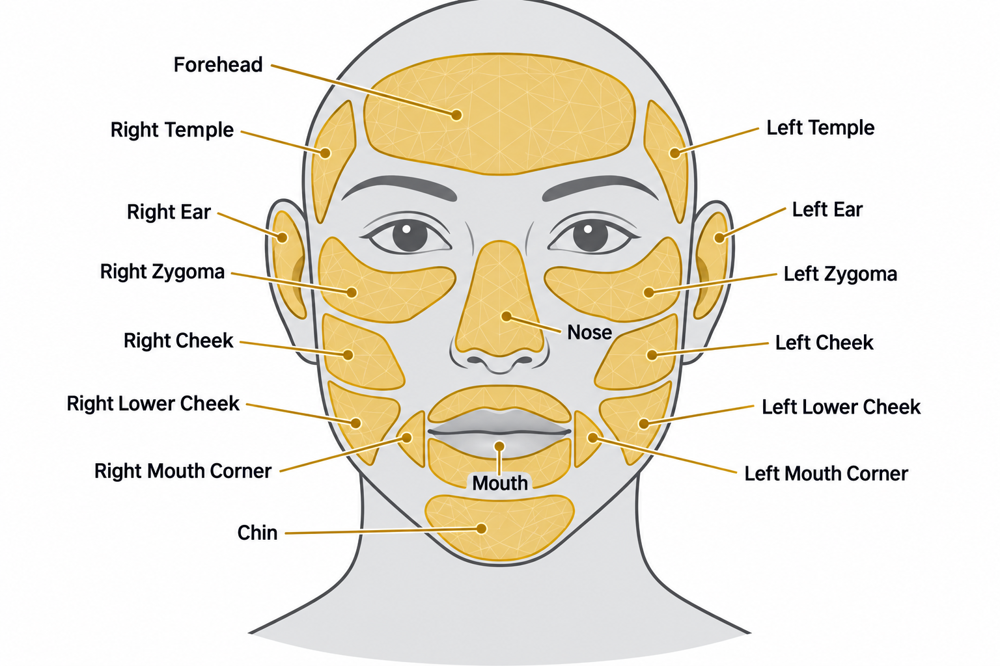

# Context Optimizing
---
## Overview
This project applies event-based additive corrections to retargeted sign-language animation. Current optimizations include:
- Detecting semantic hand-to-face proximity events in the source animation, map those events to corresponding target face patches. Correct the target animation based on that.

### Hand-to-face optimalization algorithm
First we prepare the avatars:
1. Define face patches on source avatar, center is anchor.
2. Define interaction points on the fingers of the source avatar.
3. Copy the data over and tweak the locations on the target avatar.
The resulting avatar looks like:


Then we build events using the source animation:
1. Anchors and bounds perform broad-phase filtering; triangle surfaces provide the exact distance.
2. Detect edges of the events.
3. On the edges use sliding window to calculate the direction approaching the event and recovering from the event.

Apply changes additively:
1. The closest moment of event (representative frame), is used to calculate a representative correction. This correction is keyframed at event start and event end.
2. On approaching start, and recovery end, add a zero keyframe so changes of the event don't propagate across the animation.

### Unreal Integration
The Unreal integration is split into three plugins:
- `SemanticSurfacePatches` owns reusable semantic surface-patch data and authoring.
- `AdditiveBoneCorrection` owns selectable-chain IK, sparse additive correction keys, and animation baking.
- `UnrealContextOptimizing` owns event detection, semantic mapping, and target safety.

## Reused modules
- `Optimization`: Adam, numerical gradients, minimization, and their unit tests. *Up for removal*
- `AnimationMath`: vectors, quaternions, rigid transforms, pose hierarchy evaluation, and their unit tests.


## Build

```powershell
cmake -S . -B build
cmake --build build --config Debug
ctest --test-dir build -C Debug --output-on-failure
```

